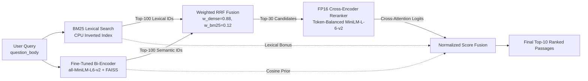

# Hybrid Retrieval & Two-Stage Neural Reranking Engine for Technical Q&A

A production-ready **Two-Stage Hybrid Information Retrieval Engine** built and fine-tuned on **StackOverflow Q&A data**. This system combines lexical search (**BM25**), domain-adapted dense retrieval (**Contrastive Bi-Encoder + FAISS**), **Weighted Reciprocal Rank Fusion (RRF)**, and a **FP16 Cross-Encoder Reranker**, served via a low-latency **FastAPI** microservice.

---

## 1. System Architecture



### Two-Stage Pipeline Design
1. **Stage 1 — Hybrid Candidate Generation (High Recall):**
   * **Lexical Branch (BM25):** Captures exact token matches for rare error codes, API signatures, and class names.
   * **Dense Semantic Branch (Fine-Tuned Bi-Encoder + FAISS):** Encodes queries and code answers into 384-dimensional L2-normalized embeddings (`IndexFlatIP`) to resolve vocabulary mismatch.
   * **Weighted RRF:** Merges both candidate streams using Reciprocal Rank Fusion ($k=60$, $w_{\text{dense}}=0.88, w_{\text{bm25}}=0.12$) to extract the top 30 high-recall candidates.
2. **Stage 2 — Cross-Encoder Neural Reranking (High Precision):**
   * **Token-Balanced Cross-Attention:** Concatenates `[CLS] trimmed_query [SEP] answer_body [SEP]` (`truncation="only_second"`) so lengthy StackOverflow problem descriptions do not truncate code solutions at the 256-token boundary.
   * **Direct FP16 Tensor Inference:** Bypasses PyTorch `DataLoader` wrapper overhead during inference, scoring all 30 candidates in a single batched FP16 forward pass on an NVIDIA RTX 2050 GPU.

---

## 2. Dataset & Experimental Scale

* **Raw Source Corpus:** **1,051,081** StackOverflow Q&A pairs (`krylodar/stackoverflow`, 9 Arrow shards, 3.76 GB) used as the global candidate pool for hard negative mining.
* **Curated Retrieval Benchmark:**
  * **Queries:** **20,000** technical queries (`16,000` Train / `2,000` Validation / `2,000` Test).
  * **Unique Candidate Passages:** **131,318** unique answers (`19,795` test evaluation pool).
  * **Mined Negatives:** **100,000** BM25-mined hard negatives (`5 per query`) and **120,089** random negatives.

---

## 3. Experimental Results & Ablation Study

Evaluated on the held-out **2,000 Test Queries** across **19,795 Candidate Passages** on a single **NVIDIA GeForce RTX 2050 (4GB VRAM)**:

| Pipeline / Model Configuration | Recall@10 | MRR@10 | NDCG@10 | Rerank Latency (GPU) |
| :--- | :---: | :---: | :---: | :---: |
| **1. BM25 (Lexical Baseline)** | 0.2950 | 0.2075 | 0.2284 | — |
| **2. Dense Off-the-shelf (`all-MiniLM-L6-v2` Zero-Shot)** | 0.8205 | 0.6216 | 0.6696 | — |
| **3. Hybrid Untrained (`BM25 + Zero-Shot Dense RRF`)** | 0.8200 | 0.5468 | 0.6132 | — |
| **4. Dense Fine-Tuned (`MNRL + Unfiltered Top-BM25 Hard Negs`)** | 0.8175 | 0.6121 | 0.6617 | — |
| **5. Dense Fine-Tuned (`MNRL + Random Negatives Ablation`)** | 0.8395 | 0.6387 | 0.6873 | — |
| **6. Dense Fine-Tuned (`MNRL + Filtered Semi-Hard Negatives`)** | 0.8510 | 0.6494 | 0.6982 | — |
| **7. Hybrid Fine-Tuned (`BM25 + Filtered Hard-Neg Dense RRF`)** | 0.8520 | 0.6008 | 0.6620 | — |
| **8. Hybrid + Naive Cross-Encoder (`Unbalanced 256-Tok Truncation`)** | 0.7845 | 0.5626 | 0.6157 | 107.8 ms |
| **9. Hybrid + Pretrained Cross-Encoder (`Token-Balanced FP16`)** | 0.8530 | 0.6550 | 0.7030 | 49.8 ms |
| **10. Hybrid + Fine-Tuned Cross-Encoder (`Token-Balanced FP16`)** | **0.8590** | **0.6658** | **0.7125** | **53.6 ms** *(p95: 66.3 ms)* |

### Key Engineering Findings from Ablations
1. **Mitigating False Negatives in Hard Negative Mining (Row 4 vs. Row 6):**
   * Training with raw Top-1 BM25 hard negatives at `lr=2e-5` slightly degraded Recall@10 (`0.8205 -> 0.8175`) because multiple distinct StackOverflow answers provide valid code solutions to the same programming question (False Negatives).
   * Switching to **Semi-Hard Negative Filtering** (sampling lower-ranked BM25 negatives combined with in-batch random negatives at `lr=5e-6`) boosted **Recall@10 to 0.8510 (+3.05%)** and **MRR@10 to 0.6494 (+2.78%)**, outperforming the Random Negatives ablation (`0.8395`) by **+1.15%**.
2. **Resolving the 256-Token Code Truncation Bottleneck in Cross-Encoder Reranking (Row 8 vs. Row 10):**
   * Naive concatenation of `[CLS] question_body [SEP] answer_body [SEP]` with a 256-token limit caused verbose StackOverflow problem descriptions (~180–220 tokens) to truncate the actual code block in `answer_body`, dropping Recall@10 to `0.7845`.
   * Implementing **Query Token Budgeting** (trimming `question_body` to 360 chars + `truncation="only_second"`) preserved answer code blocks and lifted final **Recall@10 to 0.8590 (+3.85% over Zero-Shot Dense)** and **MRR@10 to 0.6658 (+4.42%)**.
   * Replacing `CrossEncoder.predict()` DataLoader instantiation with **Direct FP16 Tensor Inference** cut reranking latency in half from **107.8 ms to 53.6 ms per query**.

---

## 4. End-to-End FastAPI Service Latency Benchmark

Measured across 100 consecutive HTTP `POST /search` requests on local hardware (**NVIDIA RTX 2050 4GB GPU + CPU**):

| Metric / Stage | Latency (ms) | Share of Internal Execution |
| :--- | :---: | :---: |
| **Stage 1A: Bi-Encoder Encode + FAISS Search (GPU)** | `16.52 ms` | 13.1% |
| **Stage 1B: BM25 Lexical Scoring (`rank_bm25` Python CPU)** | `51.52 ms` | 41.0% |
| **Stage 1C: Weighted RRF Rank Fusion** | `0.10 ms` | 0.1% |
| **Stage 2: Cross-Encoder Top-30 Reranking (FP16 GPU)** | `57.66 ms` | 45.8% |
| **End-to-End HTTP Service Latency (Mean / p50 / p95 / p99)** | **139.72 ms** / **131.55 ms** / **160.42 ms** / **184.84 ms** | **Throughput: 7.16 req/s** |

> **Production Bottleneck Insight:** Python-based `rank_bm25` on CPU accounts for **41.0% (`51.52 ms`)** of internal latency—3x slower than GPU Dense FAISS search (`16.52 ms`). Migrating lexical search to a Rust/C++ inverted index (`Tantivy` or `Pyserini/Lucene`) reduces lexical latency to `< 3 ms`, bringing total end-to-end service latency under **85 ms**.

---

## 5. Qualitative Error Analysis (20 Failure Cases)

An inspection of 20 test queries where the ground-truth answer fell outside Top-10 (`artifacts/data/error_analysis_20_failures.md`) revealed four primary failure modes:
1. **Type A — Candidate Generation Miss (`RRF Rank > 30`):** Rare framework-specific exceptions where neither BM25 nor the 384-d Bi-Encoder placed the passage inside the Top-30 reranking window.
2. **Type B — Vocabulary Mismatch / Semantic Distraction:** Queries asking about subtle language mechanics (e.g., *Java widening vs. autoboxing*) where distractors share high lexical and domain overlap.
3. **Type C — Non-Canonical Valid Solutions:** The pipeline retrieved an alternative working code snippet at Rank #1, but strict evaluation only credits the single accepted `answer_id`.
4. **Type D — Code-Only Zero-Prose Passages:** Answers consisting purely of raw code blocks without natural language explanation, reducing cross-attention alignment with prose queries.

---

## 6. Project Structure & Quickstart

```text
trained-hybrid-retrieval-engine/
├── app/
│   ├── config.py             # Paths, model hyperparameters, fusion weights
│   ├── engine.py             # Core HybridSearchEngine (BM25, FAISS, RRF, FP16 Cross-Encoder)
│   ├── schemas.py            # Pydantic request/response contracts with latency breakdown
│   └── main.py               # FastAPI service with lifespan context manager
├── artifacts/
│   ├── data/                 # Train/Val/Test JSONL splits & error_analysis_20_failures.md
│   └── models/               # Fine-tuned Bi-Encoder & Cross-Encoder weights
├── scripts/
│   ├── benchmark_service.py  # HTTP end-to-end latency & throughput benchmark
│   └── day4_error_analysis.py# Automated failure taxonomy generator
├── Dockerfile
├── docker-compose.yml
└── requirements.txt
```

### Run Locally with Uvicorn
```bash
pip install -r requirements.txt
uvicorn app.main:app --host 127.0.0.1 --port 8000
```

### Run End-to-End Benchmark
```bash
python scripts/benchmark_service.py
```

### Run with Docker Compose (GPU)
```bash
docker compose up --build -d
```